<div align="center">

  <!-- Desktop Animated Hero (Picture element for dark/light & mobile adaptability) -->
  <a href="https://github.com/vpnnagendra-a11y">
    <picture>
      <source media="(max-width: 600px)" srcset="assets/animated-hero-mobile.svg">
      <source media="(prefers-reduced-motion: reduce)" srcset="assets/hero-static.svg">
      
    </picture>
  </a>

  <br/>

  <!-- Interactive Quick-Action Action Bar -->
  <p align="center">
    <a href="https://github.com/vpnnagendra-a11y/job-nex-project2">
      
    </a>
    &nbsp;
    <a href="https://www.linkedin.com/in/nagendra-vannempalli" target="_blank">
      
    </a>
    &nbsp;
    <a href="mailto:vpnnagendra@gmail.com?subject=Job%20Opportunity%20-%20Nagendra%20Vannempalli">
      
    </a>
    &nbsp;
    <a href="mailto:vpnnagendra@gmail.com?subject=Resume%20Request%20-%20Nagendra%20Vannempalli">
      
    </a>
  </p>

  

</div>

<br/>

## 🎯 Executive Summary

I am a **Python AI Developer | Backend Engineer** specializing in high-throughput **MySQL relational data pipelines**, production-ready **REST APIs** built with **FastAPI**, and machine learning applications. My engineering focus combines rigorous relational database optimization (stored procedures, CTEs, indexing) with applied machine learning and generative LLM orchestration.

- ⚡ **Engineering Impact**: Reduced database pipeline runtimes by **30%** and boosted query performance by **40%** across production database instances.
- 🤖 **Applied Machine Learning**: Built and deployed Scikit-learn predictive regression models achieving **R² > 0.85** with sub-second inference latency.
- 🛡️ **Full-Stack Architecture**: Architected end-to-end platforms featuring JWT-based role-based access control (RBAC), multi-role administrative oversight, and candidate-matching engines.
- 📍 **Location**: Bengaluru, India (`UTC+05:30` / IST) • Open to on-site, hybrid, and remote roles.

---

## 🏆 Verified Engineering Achievements

```yaml
Data Pipeline Optimization: "Accelerated MySQL batch workloads by 30% via CTEs, triggers, and stored procedures"
Machine Learning Efficacy:   "Achieved R² > 0.85 across 3+ production regression models using Scikit-learn"
Database Query Throughput:  "Engineered view architectures and subquery plans improving query efficiency by 40%"
Sub-Second Inference:       "Delivered real-time prediction service leveraging Streamlit and serialized model pipelines"
Production Deliverables:     "Shipped 20+ Python scripts and normalized MySQL modules supporting live analytics"
```

---

## 🚀 Featured Flagship Projects

<table>
  <tr>
    <td width="60%" valign="top">
      <h3>01. JobNex — Career Intelligence &amp; Applicant Management Platform</h3>
      <p>
        An enterprise-grade talent acquisition and candidate fit platform. Features a semantic resume-to-job matching engine that calculates proficiency compatibility, highlights skill gaps, generates custom learning paths, and provides automated administrative job-posting governance.
      </p>
      <ul>
        <li><b>Security &amp; RBAC:</b> Multi-role authorization (<code>admin</code>, <code>recruiter</code>, <code>user</code>) powered by JWT tokens, bcrypt encryption, and strict manual posting approvals.</li>
        <li><b>Recruiter Engine:</b> Automated resume parsing with algorithmic candidate ranking and fit score computation.</li>
        <li><b>Database:</b> High-performance relational MySQL schema with dedicated audit trails and access request workflows.</li>
      </ul>
      <p>
        <b>Tech Stack:</b> <code>Python</code> • <code>FastAPI</code> • <code>MySQL</code> • <code>JWT / RBAC</code> • <code>HTML5 / CSS3 / JavaScript</code>
      </p>
      <p>
        👉 <a href="https://github.com/vpnnagendra-a11y/job-nex-project2"><b>Inspect Repository: job-nex-project2</b></a> • <a href="https://github.com/vpnnagendra-a11y/jobnex_analgonex_product">Core Analyzer Engine</a>
      </p>
    </td>
    <td width="40%" valign="middle" align="center">
      <a href="https://github.com/vpnnagendra-a11y/job-nex-project2">
        <br/><br/>
        
      </a>
    </td>
  </tr>

  <tr>
    <td width="60%" valign="top">
      <h3>02. Algonex Enterprise Intern &amp; Student Management System</h3>
      <p>
        A comprehensive backend relational management suite built to automate workflow routing, student credential validation, and administrative oversight across multi-tiered departments.
      </p>
      <ul>
        <li><b>Optimized Schemas:</b> Relational schema modeling with referential integrity constraints, automated indexing, and stored procedures.</li>
        <li><b>Validation Engine:</b> Strict input verification workflows eliminating invalid record insertions and reducing processing overhead.</li>
        <li><b>Performance:</b> Scalable query construction with execution plans tuned for fast filtering and reporting.</li>
      </ul>
      <p>
        <b>Tech Stack:</b> <code>Python</code> • <code>MySQL 8.0</code> • <code>Stored Procedures</code> • <code>Database Triggers</code>
      </p>
      <p>
        👉 <a href="https://github.com/vpnnagendra-a11y/algonex_intern_management_system"><b>Inspect Repository: algonex_intern_management_system</b></a>
      </p>
    </td>
    <td width="40%" valign="middle" align="center">
      <a href="https://github.com/vpnnagendra-a11y/algonex_intern_management_system">
        <br/><br/>
        
      </a>
    </td>
  </tr>

  <tr>
    <td width="60%" valign="top">
      <h3>03. Algorithmic Problem Solving &amp; Data Structure Suite</h3>
      <p>
        A collection of optimized data structure implementations and algorithmic solutions covering memory efficiency, time-complexity analysis, and low-latency algorithmic patterns in Python.
      </p>
      <ul>
        <li><b>Core Implementations:</b> Graph search algorithms, dynamic programming formulations, balanced trees, and custom hash mapping.</li>
        <li><b>Benchmarking:</b> Asymptotic analysis with performance profiling comparing algorithmic scaling against standard collections.</li>
      </ul>
      <p>
        <b>Tech Stack:</b> <code>Python</code> • <code>Algorithms &amp; Data Structures</code> • <code>Complexity Optimization</code>
      </p>
      <p>
        👉 <a href="https://github.com/vpnnagendra-a11y/Data-Structure-Algorithm"><b>Inspect Repository: Data-Structure-Algorithm</b></a>
      </p>
    </td>
    <td width="40%" valign="middle" align="center">
      <a href="https://github.com/vpnnagendra-a11y/Data-Structure-Algorithm">
        <br/><br/>
        
      </a>
    </td>
  </tr>
</table>

<details>
<summary><b>📂 View More Repositories (Click to expand)</b></summary>
<br/>

| Repository | Focus Area | Technology | Link |
| :--- | :--- | :--- | :--- |
| **`ALGONEX_PAYMENT_SYSYTEM2`** | Payment workflow state-machine validation and backend ledger persistence | `Python`, `SQL`, `Transaction Control` | [View Repo](https://github.com/vpnnagendra-a11y/ALGONEX_PAYMENT_SYSYTEM2) |
| **`jobnex_analgonex_product`** | Dedicated machine-assisted resume parsing and JD skill gap detection engine | `Python`, `FastAPI`, `MySQL` | [View Repo](https://github.com/vpnnagendra-a11y/jobnex_analgonex_product) |
| **`-loops-and-conditions`** | Foundational computational logic benchmarks, automated condition checks, and iteration efficiency | `Python`, `Logic Architecture` | [View Repo](https://github.com/vpnnagendra-a11y/-loops-and-conditions) |

</details>

---

## 🛠️ Technical Competencies

<div align="center">

| Domain | Verified Proficiencies |
| :--- | :--- |
| **Languages** | `Python (Advanced)` • `SQL (Expert Queries & DDL)` • `C` • `JavaScript (ES6+)` • `HTML5 / CSS3` |
| **Backend & APIs** | `FastAPI` • `RESTful API Architecture` • `JWT RBAC Authentication` • `Uvicorn` • `Pydantic Data Validation` |
| **AI / Machine Learning** | `Scikit-learn (Regression & Classification)` • `Pandas` • `NumPy` • `Matplotlib` • `LLM APIs (Gemini/GenAI)` • `Prompt Engineering` |
| **Databases** | `MySQL 8.0` • `Stored Procedures` • `Triggers` • `Common Table Expressions (CTEs)` • `Relational Indexing` |
| **Tools & Platforms** | `Git & GitHub Workflow` • `VS Code` • `Jupyter Notebook` • `Streamlit` • `Linux / Windows Environments` |

</div>

---

## 💼 Professional Experience

```text
┌────────────────────────────────────────────────────────────────────────────────────────┐
│  Algonex IT Solutions, Bengaluru, India                                               │
│  Role: Python AI Developer                                         May 2026 – Sep 2026 │
├────────────────────────────────────────────────────────────────────────────────────────┤
│  • Engineered 5+ end-to-end MySQL pipelines using triggers, stored procedures, and    │
│    CTEs, reducing execution cycle times by 30%.                                       │
│  • Trained and validated 3+ regression models with Scikit-learn, consistently         │
│    surpassing an R² metric of 0.85 across validation datasets.                        │
│  • Deployed a real-time prediction microservice leveraging Streamlit and Pickle        │
│    serialization, achieving sub-second request-to-response latency.                    │
│  • Refactored complex views and relational subqueries across 10+ schemas, elevating   │
│    overall database query throughput by 40%.                                          │
│  • Delivered 20+ production-ready Python utility scripts and modular backend services.│
└────────────────────────────────────────────────────────────────────────────────────────┘
```

---

## 🎓 Education & Credentials

- **Bachelor of Engineering (B.E.) in Electronics & Communication Engineering**  
  *Cambridge Institute of Technology* • *(2020 – 2024)*

---

## 📊 GitHub Analytics

<div align="center">
  <table border="0">
    <tr>
      <td>
        
      </td>
      <td>
        
      </td>
    </tr>
  </table>

  
</div>

---

## 🤝 Open For Collaboration & Opportunities

```text
┌──────────────────────────────────────────────────────────────────────────────────────┐
│  🟢 STATUS: Actively Seeking Opportunities                                           │
│  Target Roles: Python Developer | AI Engineer | Backend Software Engineer             │
│  Location:     Bengaluru, India (Open to Relocation / Hybrid / Remote)               │
│  Direct Contact: vpnnagendra@gmail.com                                               │
└──────────────────────────────────────────────────────────────────────────────────────┘
```

<div align="center">

  **Looking to build scalable backend systems or AI-powered workflows? Let's connect!**

  <a href="mailto:vpnnagendra@gmail.com">
    
  </a>
  &nbsp;&nbsp;
  <a href="https://www.linkedin.com/in/nagendra-vannempalli" target="_blank">
    
  </a>

</div>
